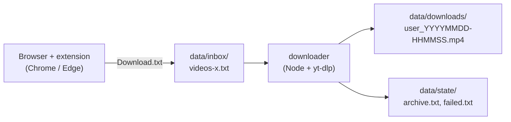

# x-video-saver

Save the links of videos on X (Twitter) while you browse, then download them later with [yt-dlp](https://github.com/yt-dlp/yt-dlp).

> A personal backup tool for content you like. Respect the platform's terms and the creators' rights, and do not redistribute what you download. 
> **The project never stores or sends your credentials.**

## How it works



1. The **extension** puts a "Save video" button over every video on x.com (or saves them automatically, if you prefer) and keeps a list of post links.
2. You export the list from the popup and put it in `data/inbox/`.
3. The **downloader** validates the list and runs yt-dlp for each link, with retries, a circuit breaker for network failures, and resume.

## Quick start

Requirements: Node 18.3+, [yt-dlp](https://github.com/yt-dlp/yt-dlp), and [ffmpeg](https://ffmpeg.org) (recommended).

```bash
# 1. Extension: chrome://extensions (or edge://extensions) -> Developer mode
#    -> Load unpacked -> select the extension/ folder

# 2. Settings (optional, but saves typing)
cp xvs.config.example.json xvs.config.json

# 3. Put the exported videos-x.txt in data/inbox/, then:
npm run verify      # checks the list, downloads nothing
npm run download    # downloads
```

Run `node downloader/src/download.mjs --help` for every option. Details: [extension/README.md](extension/README.md) and [downloader/README.md](downloader/README.md).

## Repository layout

```
x-video-saver/
├── extension/        Manifest V3 extension (Chrome / Edge), plain JS, no build
├── downloader/       Node CLI that drives yt-dlp (no runtime dependencies)
├── shared/           Contract fixtures used by the tests of both sides
├── docs/             Architecture and decision records
├── data/             Your lists, state and videos (ignored by git)
└── xvs.config.example.json
```

## Configuration

`xvs.config.json` (copied from the example, ignored by git). Precedence: command-line flags > config file > defaults. Paths in the file are relative to the repository root.

| Key                                                                      | Default                      | Meaning                                                          |
| ------------------------------------------------------------------------ | ---------------------------- | ---------------------------------------------------------------- |
| `list`                                                                   | `data/inbox/videos-x.txt`    | Link list to read                                                |
| `stateDir`                                                               | `data/state`                 | `archive.txt`, `failed.txt`                                      |
| `downloadsDir`                                                           | `data/downloads`             | Where you want videos go                                                  |
| `ytdlp`                                                                  | `yt-dlp`                     | yt-dlp executable                                                |
| `cookiesFromBrowser`                                                     | `null`                       | Browser to read the login from (`firefox` works best on Windows) |
| `cookiesFile`                                                            | `null`                       | Alternative: a Netscape `cookies.txt`                            |
| `delay`, `retries`, `backoff`, `maxConsecutiveFailures`, `wait`, `limit` | `2`, `2`, `5`, `3`, `0`, `0` | Run rules, see the downloader README                             |

## Design decisions

Short records of why things are the way they are: [docs/decisions](docs/decisions/README.md). Start with [architecture](docs/architecture.md).

## Development

```bash
npm install        # dev tools only: TypeScript (type checks), ESLint, Prettier
npm run check      # format check + lint + type check + tests
```

## Roadmap

- Hand-off through the browser's Downloads folder: the popup writes the list, the downloader imports it into `data/inbox/`.
- Optional one-click bridge (Native Messaging) with progress in the popup.
- Firefox support for the extension; icons and store packaging.
- CI, license, changelog.

## License

Not defined yet.
